<div align="center">

# Lume

**Gestionale completo per un ristorante gourmet**
sala · comande · cucina · prenotazioni · menù · magazzino · statistiche · AI

Spring Boot 3.5 · Java 17 · Thymeleaf · Spring Security · Spring Data JPA · MySQL · Spring AI (Groq)


</div>

Lume è un progetto completo: da una parte il **sito del ristorante**, dove i clienti leggono il menù e prenotano un tavolo vedendo i posti liberi in tempo reale; dall'altra il **gestionale** usato da sala, cucina e titolare durante il servizio.
Non usa librerie front-end: grafici, mappa della sala, monitor della cucina e tutte le interazioni sono scritte in HTML, CSS e JavaScript puro.

---

## Cosa fa

### Sito pubblico
- **Home** con i piatti firma, presi dal menù del gestionale.
- **Menù** sempre aggiornato: categorie, allergeni (Reg. UE 1169/2011), vini consigliati e filtri *vegetariano · senza glutine · senza lattosio · senza pesce*. I piatti esauriti spariscono da soli.
- **Prenotazione online** in quattro passaggi, con gli orari liberi calcolati dal vivo in base alla capienza e alla durata media di un tavolo. Il lunedì risulta chiuso, i gruppi numerosi restano *da confermare* e il tavolo viene assegnato in automatico.
- **Area "La mia prenotazione"**: si ritrova con un codice (es. `LM-7K2QX`), si aggiunge al calendario del telefono con un file `.ics` e si può annullare inserendo il proprio telefono.

### Gestionale (tre ruoli: amministratore, sala, cucina)
| | |
|---|---|
| **Panoramica** | Incassi del giorno confrontati con ieri alla stessa ora, grafico delle ultime due settimane, sala in miniatura, prossimi arrivi, comande in cucina e avvisi di magazzino. |
| **Sala** | Mappa interattiva dei tavoli con cinque stati (libero, prenotato, occupato, piatti pronti, conto). Si aggiorna da sola ogni pochi secondi e l'amministratore può trascinare i tavoli per ridisegnare la sala. |
| **Comanda** | Scelta rapida dei piatti con ricerca e categorie, note per la cucina, uscite (antipasti, secondi, dolci), invio in cucina, preconto stampabile con divisione alla romana e chiusura del conto con metodo di pagamento, sconto e calcolo del resto. Tutte le azioni avvengono senza ricaricare la pagina. |
| **Cucina** | Monitor scuro a tutto schermo pensato per un tablet. Ogni piatto passa da *in coda* a *sul fuoco* a *pronto* con un tocco, i ticket in ritardo diventano arancioni e poi rossi, e le nuove comande suonano un "din-don" generato dal browser. |
| **Prenotazioni** | Agenda giornaliera di pranzo e cena, riempimento dei prossimi 15 giorni, conferma delle richieste e pulsante *Fai accomodare* che apre direttamente il tavolo collegato alla prenotazione. |
| **Menù** | Categorie ordinabili, disponibilità attivabile al volo e scheda piatto con ricetta. Il **food cost** si calcola dal vivo, c'è l'anteprima di come il piatto apparirà sul sito e un pulsante **"Scrivi con l'AI"** che compone descrizione e abbinamento. |
| **Magazzino** | Giacenze con soglie di riordino, movimenti di carico, spreco e inventario, e **scarico automatico** degli ingredienti quando un conto si chiude, in base alle ricette. Gli ordini ai fornitori sono raggruppati e pronti da copiare su WhatsApp o in una mail. |
| **Statistiche** | Incassi, coperti, scontrino medio, ore di punta, incasso per categoria, metodi di pagamento e classifica dei piatti, più l'esportazione in CSV e un'**analisi scritta dall'AI** con tre consigli pratici. |
| **Impostazioni** | Gestione di tavoli e account dello staff. Deve sempre restare almeno un amministratore e nessuno può disattivare il proprio account. |

E inoltre:
- **tema scuro**;
- **palette comandi** con <kbd>Ctrl</kbd>+<kbd>K</kbd>;
- notifiche in alto;
- interfaccia responsive per smartphone;
- font ospitati in locale, senza chiamate a Google Fonts.

---

## Screenshot

| Panoramica | Sala |
|---|---|
| 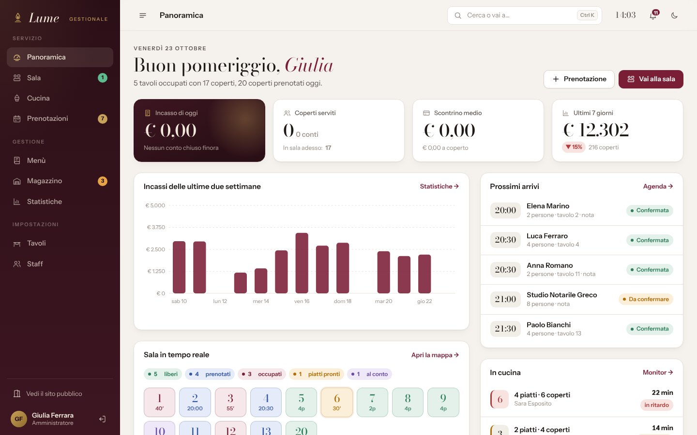 | 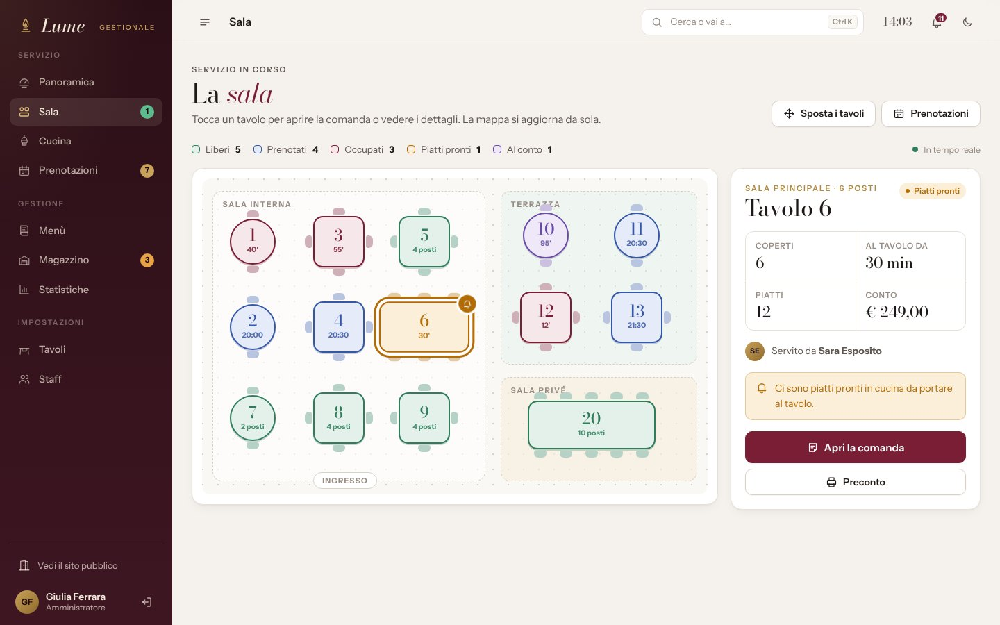 |
| **Comanda** | **Monitor della cucina** |
| 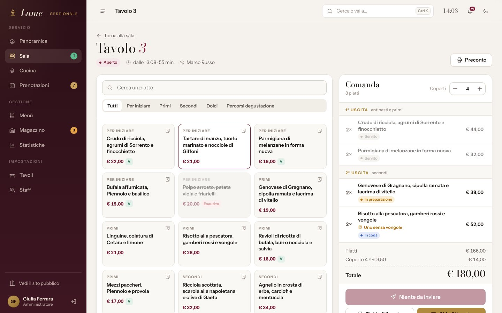 | 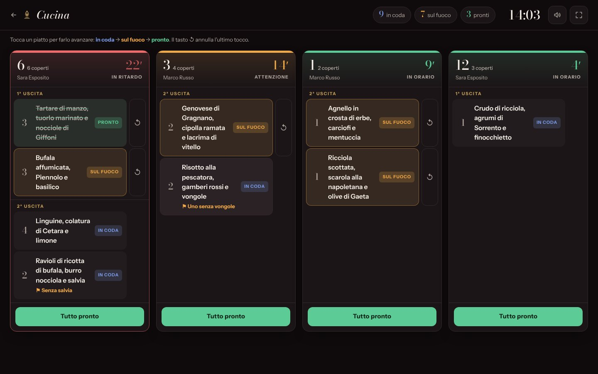 |
| **Statistiche** | **Scheda piatto con food cost** |
| 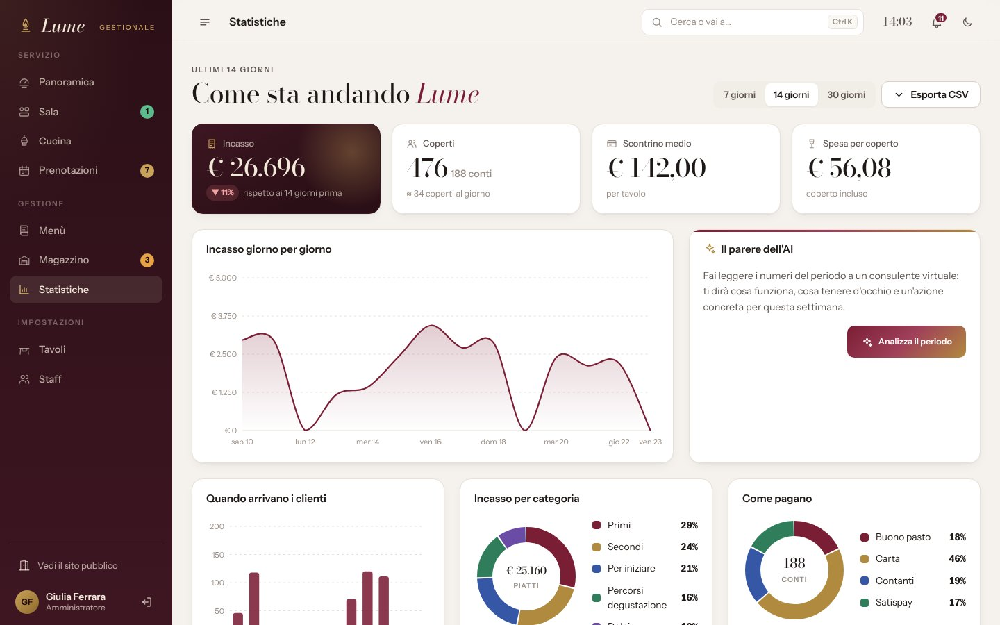 | 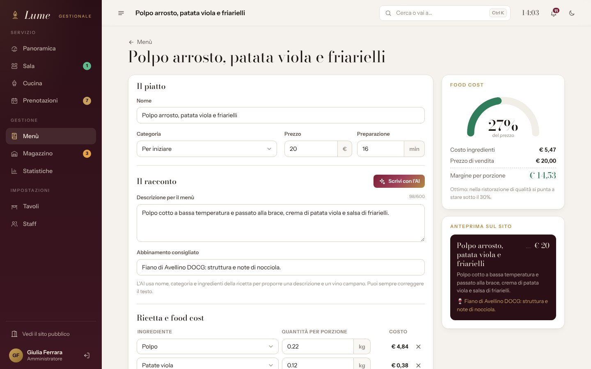 |
| **Prenotazioni** | **Magazzino** |
| 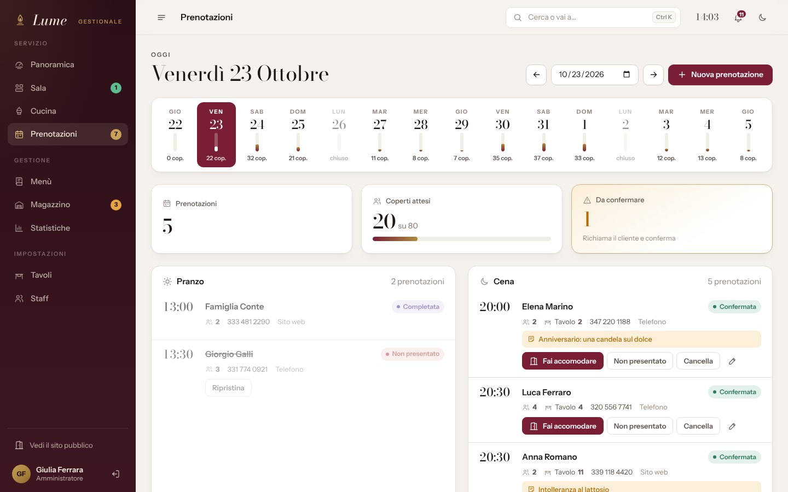 | 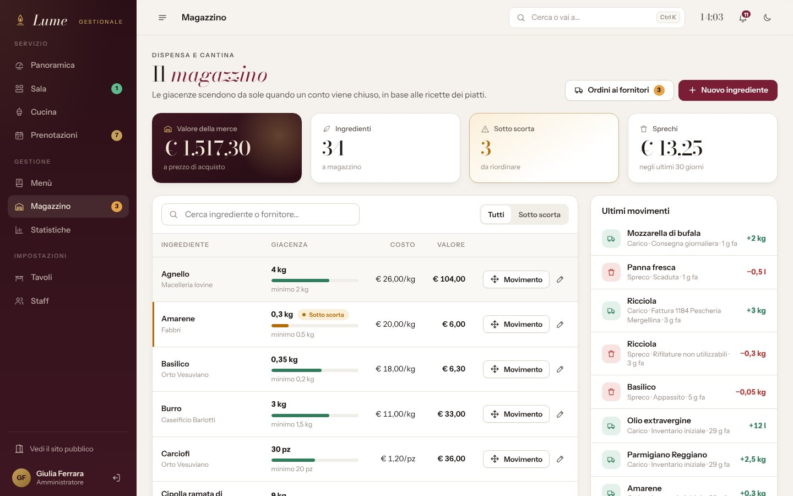 |
| **Menù del sito** | **Prenotazione online** |
| 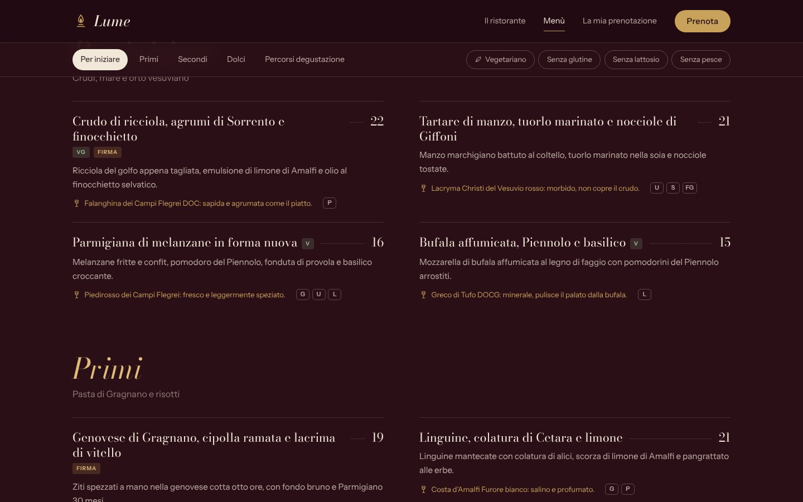 | 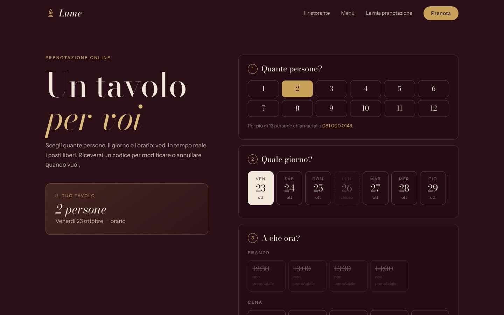 |
| **Tema scuro** | **Accesso staff** |
| 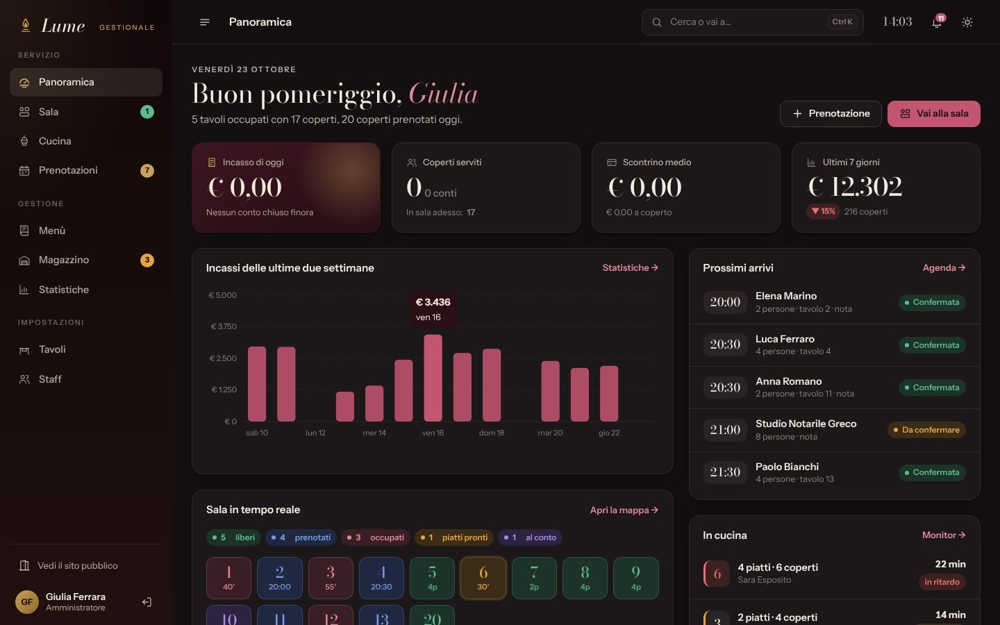 | 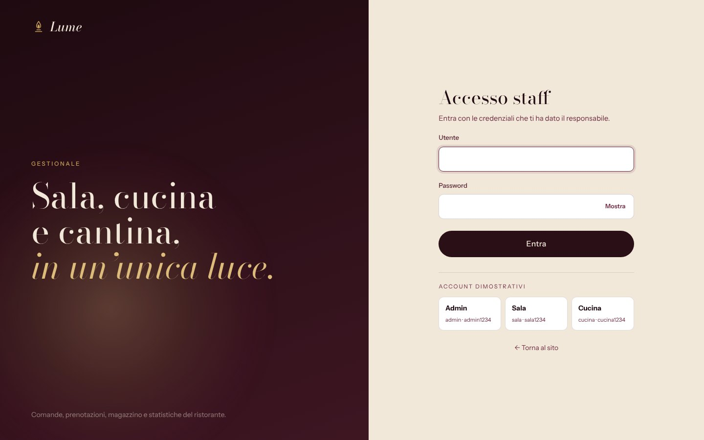 |

<p align="center">
  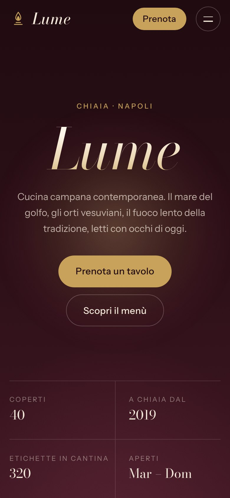
  &nbsp;&nbsp;
  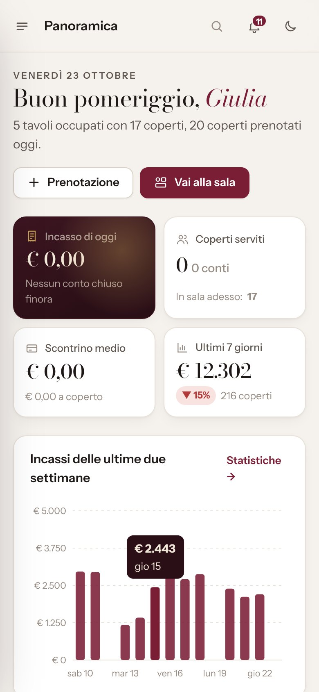
</p>

---

## Avvio rapido

**Requisiti:** Java 17 o superiore, Maven (oppure Eclipse / IntelliJ / VS Code) e MySQL 8.

1. **Database.** Basta che MySQL sia acceso: il database `lume_ristorante` viene creato da solo al primo avvio. I valori predefiniti sono `127.0.0.1:3307` con utente e password `root`/`root`, e si cambiano con le variabili d'ambiente:

   | Variabile | Predefinito |
   |---|---|
   | `DB_HOST` | `127.0.0.1` |
   | `DB_PORT` | `3307` |
   | `DB_NAME` | `lume_ristorante` |
   | `DB_USER` / `DB_PASSWORD` | `root` / `root` |

2. **Intelligenza artificiale (facoltativa).** Crea una chiave gratuita su [console.groq.com/keys](https://console.groq.com/keys) e impostala nella variabile d'ambiente `GROQ_API_KEY`. Senza la chiave tutto funziona, solo i pulsanti AI mostrano un avviso.

   ```powershell
   # Windows (PowerShell), poi riapri il terminale / Eclipse
   setx GROQ_API_KEY "gsk_la-tua-chiave"
   ```
   ```bash
   # macOS / Linux
   export GROQ_API_KEY="gsk_la-tua-chiave"
   ```
   In Eclipse la variabile si può anche aggiungere in *Run → Run Configurations → Environment*.

3. **Avvio.**
   ```bash
   mvn spring-boot:run
   ```
   Poi apri **http://localhost:8080**.

Al primo avvio Lume carica un **ristorante dimostrativo completo**:
- 20 piatti con ricette, 34 ingredienti e 14 tavoli;
- quattro settimane di conti chiusi, un servizio in corso con comande in cucina e prenotazioni per i prossimi giorni.

### Account dimostrativi
| Ruolo | Utente | Password | Cosa vede |
|---|---|---|---|
| Amministratore | `admin` | `admin1234` | tutto |
| Sala | `sala` | `sala1234` | sala, comande, prenotazioni |
| Cucina | `cucina` | `cucina1234` | monitor della cucina, magazzino |

Il gestionale è su **/gestione**; nella pagina di accesso ci sono anche i pulsanti per entrare al volo.

---

## Architettura

```
src/main/java/it/manuel/ristorante
├── config/       sicurezza e ruoli, client AI, dati dimostrativi, proprietà "lume.*"
├── model/        entità JPA (Ordine, RigaOrdine, Piatto, Ingrediente, Prenotazione…) ed enum di stato
├── repository/   Spring Data JPA, solo query derivate dai nomi dei metodi
├── service/      tutte le regole del ristorante (capienza, stati della comanda, magazzino, statistiche, AI)
├── dto/          form validati con Bean Validation e record per le viste
└── web/          controller MVC e API JSON, gestione centralizzata degli errori
src/main/resources
├── templates/    Thymeleaf: public/ (sito), gestione/ (gestionale), fragments/ (layout)
└── static/       css/, js/ (nessuna libreria), img/icons.svg (sprite di icone), fonts/
```

Alcune scelte tecniche:
- **Regole nei service, controller sottili.** Le operazioni non valide (tavolo occupato, piatto già in cucina, conto con piatti non inviati…) lanciano un'eccezione dedicata. Un unico `@ControllerAdvice` la trasforma in un messaggio per la pagina oppure in JSON per le API.
- **AJAX senza framework.** I form marcati `data-ajax` vengono inviati con `fetch`. Il server risponde con la pagina aggiornata e il JavaScript sostituisce solo le zone `data-swap`: niente API duplicate e la pagina funziona anche senza JavaScript.
- **Aggiornamento in tempo reale.** Sala e cucina interrogano piccole API JSON e ridisegnano solo quando qualcosa è cambiato.
- **Spring AI con output strutturato.** La descrizione del piatto torna direttamente come oggetto Java (`AiPiatto`) grazie a `.entity(...)`. Groq viene usato tramite la sua API compatibile con OpenAI.
- **Sicurezza.**
  - Ruoli con Spring Security e password cifrate con BCrypt.
  - CSRF attivo anche sulle chiamate JavaScript.
  - Nessun segreto nel codice: chiave AI e credenziali del database arrivano dalle variabili d'ambiente.
- **Prezzi con `BigDecimal`** ovunque: conti, sconti, food cost e valore del magazzino.

### Test
```bash
mvn test
```
I test unitari coprono il calcolo del conto (coperto e sconto), le soglie di magazzino e la formattazione italiana di importi e durate.

---

## Configurazione

`src/main/resources/application.properties`:

| Proprietà | Significato | Predefinito |
|---|---|---|
| `lume.coperto` | costo del coperto a persona | `3.50` |
| `lume.capienza-per-turno` | coperti prenotabili nello stesso orario | `40` |
| `lume.durata-tavolo-minuti` | quanto dura in media un tavolo (serve al calcolo dei posti liberi) | `120` |
| `GROQ_MODEL` (variabile d'ambiente) | modello Groq usato dall'AI | `llama-3.3-70b-versatile` |

---

<sub>Font: Bodoni Moda e Instrument Sans, licenza SIL Open Font License (vedi `src/main/resources/static/fonts`). Ristorante, nomi e dati sono di fantasia.</sub>
